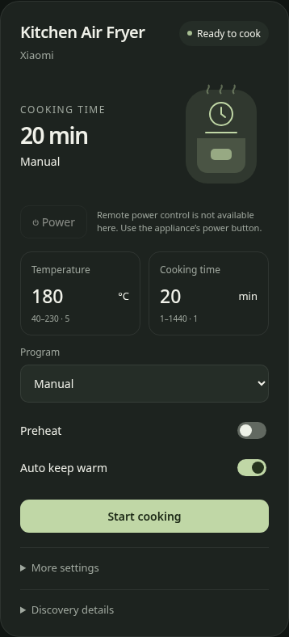
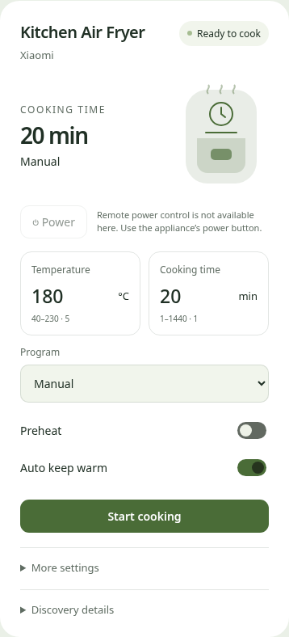

# Air Fryer Card

A Home Assistant dashboard card that discovers an air fryer's controls automatically.
Choose the device in the visual editor. Temperature, time, programs and options come
from its existing entities; no list of entity IDs is needed.

 

**Early release:** Xiaomi Miot / `careli.fryer.maf10a` is the first adapter. Automated
tests use synthetic fixtures derived from the public model spec. Real-device setting
and cooking-command validation is pending. The shared design is manufacturer agnostic;
additional integrations are not yet advertised as tested support.

## Install with HACS

1. Open HACS → menu → **Custom repositories**.
2. Add `https://github.com/nemke/air-fryer-card` with category **Dashboard**.
3. Download **Air Fryer Card**, then reload your browser.
4. Edit a dashboard → Add card → **Air Fryer**. Select your device and save.

This repository is **not yet in the default HACS catalog**. The custom-repository path
works before catalog approval. See the [HACS submission plan](docs/HACS.md).

HACS normally adds the resource automatically. If the card is missing, add this module
under dashboard resources: `/hacsfiles/air-fryer-card/air-fryer-card.js`.

For manual installation, copy the release's `air-fryer-card.js` into
`config/www/air-fryer-card.js` and add `/local/air-fryer-card.js` as a JavaScript module.

## Automatic configuration

When exactly one fryer is identified:

```yaml
type: custom:air-fryer-card
```

For multiple fryers, choose one in the visual editor. It writes:

```yaml
type: custom:air-fryer-card
device_id: YOUR_DEVICE_ID
```

Optional `title`, `include_hidden` and role `overrides` are available in the visual
editor. Overrides are only needed when an integration lacks usable semantic metadata
or has ambiguous duplicate entities. Choose by entity label; no manual ID harvesting.

## What it does

- Discovers entities by exact device membership and semantic translation keys, with
  Miot unique-ID fallback. It does not depend on English names or entity prefixes.
- Edits temperature and cooking duration inline, using live min/max/step/unit metadata.
- Shows real program options, preheat and automatic keep-warm controls.
- Keeps program selection local until **Start selected program** is pressed. Some
  fryers start cooking on a mode write; a changed program is therefore sent once
  without an additional Start command. Discard a selection without sending anything.
- Offers contextual Start, Pause, Resume and confirmed Stop for recognized MAF10A states.
- Shows power on/off on the main card when a genuine power switch is discovered,
  including Miot `on`/`switch` semantics. A reachable power switch works even when
  cooking sensors are offline. Otherwise the card explains that physical power is
  unavailable remotely. MAF10A's public spec exposes no separate power command.
- Keeps additional settings under **More settings**, with diagnostics separate.
- Retains controls when the fryer is offline; available action buttons do not imply
  the appliance is online.
- Follows HA theme and language, with English and Serbian interface labels. Installed
  program options keep the integration's labels and exact command values.
- Provides an allowlisted schema download with identifiers and names replaced.

Apply a changed numeric setting before Start. The card waits for the reported value
to match before enabling another command. Program changes are staged separately and
never sent by the dropdown itself. Starting a changed program waits for a cooking
phase to be reported; if that times out, check the appliance before trying again.
No fallback Start is sent. Selecting the already-current program uses the normal
Start button. A successful action call is a request, not proof the device changed state.

MAF10A **Turn Pot** is a read-only shake reminder even if Miot exposes it as a select.
**Turn Pot Config** is the separate writable reminder switch. No wake-up capability,
basket-open contact or live temperature is invented when the integration lacks it.

## Compatibility

Xiaomi Miot entities can be discovered on other models, but model-specific cycle
commands remain disabled for unrecognized states. Generic semantic entities can expose
typed settings/readings. Philips HomeID, Xiaomi Home, XiaomiAirFryer and VeSync adapters
are planned. See [compatibility evidence and limits](docs/COMPATIBILITY.md).

The card uses Home Assistant's existing registry/state APIs and entity services. It
does not contact manufacturer APIs, request device credentials, load runtime CDNs,
send telemetry or modify integrations/automations. Discovery, rendering and previews
make no control calls.

## Development

Node 22.12+:

```sh
npm ci --ignore-scripts
npx playwright install chromium
npm run check
npm run dev
```

Open the local preview URL printed by Vite. Its controls affect synthetic sample data
only. `npm run build` produces the standalone `dist/air-fryer-card.js` and checksum.

- [Contributing](CONTRIBUTING.md)
- [Architecture and implementation plan](docs/IMPLEMENTATION_PLAN.md)
- [Investigation](docs/INVESTIGATION.md) and [MAF10A details](docs/MAF10A_DETAILS.md)
- [HACS release/catalog roadmap](docs/HACS.md)
- [Changelog](CHANGELOG.md)

MIT licensed. Built with [Lit](https://lit.dev/), whose bundled modules retain their
BSD license notices. Integration and card sources were studied as documented in
[sources.json](docs/sources.json); their manufacturer transport code is not bundled.
